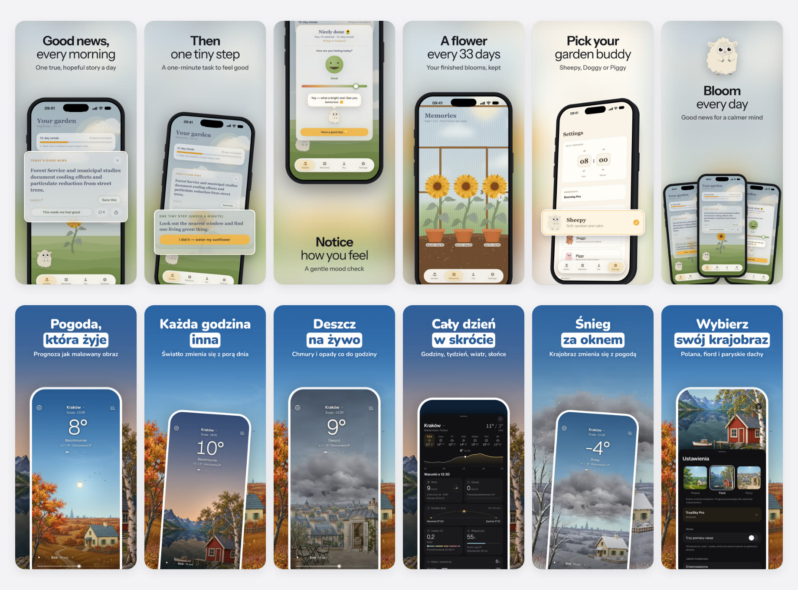
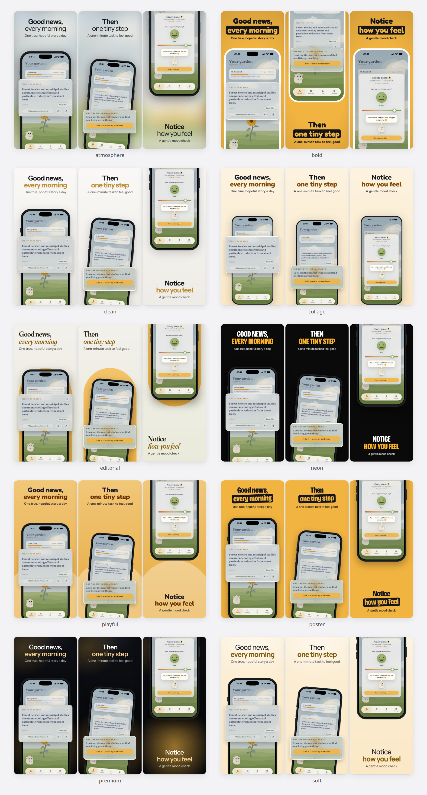
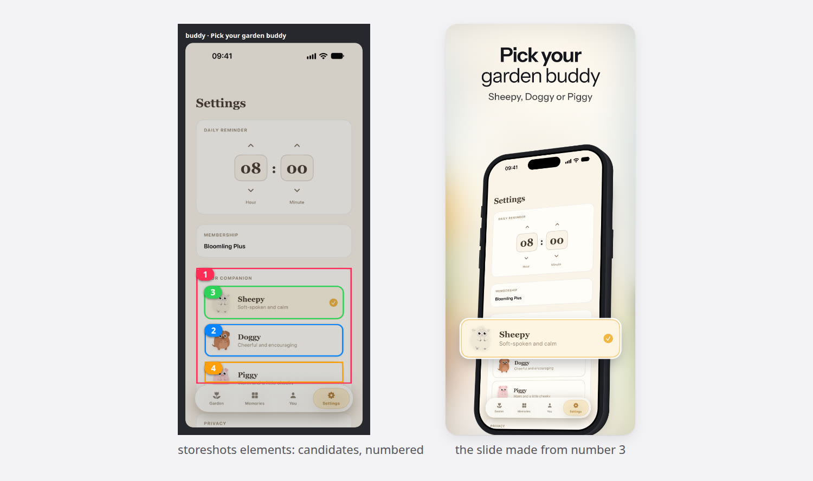

# storeshots

App Store screenshots from your real app. storeshots captures the app in the iOS Simulator (or takes screenshots you already have), composes them into slides with device frames, headlines and lifted UI, renders the exact sizes App Store Connect asks for, checks them against the store's rules and uploads them.



- **Real UI.** Slides are built around screenshots of the running app with seeded demo data. Nothing in the UI is redrawn or generated.
- **Designs are HTML.** A set is one HTML page, rendered by Chrome at 1320×2868. Slides sit on one canvas, so a phone can cross from one slide into the next. Eleven styles are included; any of them can be edited by hand.
- **The app's own art.** `assets` finds the mascots, illustrations and scenes the app already ships (and renders Rive mascots in any pose), shows them on numbered sheets, and places the chosen ones on slides: beside the phone, peeking over it, as a backdrop or on the closer.
- **Pop-outs.** `elements` finds the cards, rows and blocks on each screen, cuts them along their own shape and ranks them against the slide's headline. You (or an agent) pick by number.
- **Checks.** Size, alpha, 1–10 per set, minimum text size, one headline size, nothing cut by a slide edge. On the rendered pixels: text contrast (gradient and translucent text too), letters hidden behind a phone, texts running into each other, empty bands. Characters missing from the font, and copy App Review rejects. Contrast errors name a shade that would pass.
- **Upload.** Through the App Store Connect API: `upload` shows the plan, `upload --confirm` applies it, and sets that have not changed are skipped.
- **Scriptable.** Every command prints one JSON document on stdout and logs to stderr. Errors carry `error`, `fix` and `next` along with a distinct exit code. An agent skill is included.

## Try it

Requirements: Node 20+, ffmpeg and Chrome or Chromium (or `npx playwright install chromium`).

```bash
git clone https://github.com/MSliwa01/storeshots && cd storeshots && npm install
npm run demo                                 # builds both example projects
open examples/bloomling/store/output/review/iphone-6.9-en-sheet.png
```

The examples are two real apps, Bloomling in English and TrueSky Weather in Polish, with their captures, art and copy. See [examples/](examples/README.md).

## Use it in your app

```bash
npm link                                     # puts `storeshots` on your PATH
cd your-app
storeshots doctor
storeshots init --shots today,detail,stats   # store/ from the app's name, icon and colour
```

Write the headlines in `store/copy/en.json`, then get the screens. To capture them, the app needs a demo mode: launch arguments that open a given screen with seeded data. [references/capture.md](skills/store-screenshots/references/capture.md) has recipes for SwiftUI, Expo/React Native and Flutter. `capture` runs on a Mac with Xcode, either locally or on another Mac over SSH (`"capture": {"host": {"ssh": "my-mac"}}`). It sets the status bar to 9:41 and waits for each screen to settle.

```bash
storeshots capture                           # or: storeshots import ~/Desktop/screens
storeshots elements                          # open store/output/elements/marks.png
storeshots elements --slides today --pick 2  # lift element 2 on the "today" slide
storeshots catalog style                     # your screens in every style, numbered
storeshots catalog style --pick 3
storeshots style && storeshots build         # render, review sheets, check
storeshots upload                            # the plan; then: storeshots upload --confirm
```

The upload uses the same credentials as the `asc` CLI: `ASC_KEY_ID`, `ASC_ISSUER_ID` and `ASC_PRIVATE_KEY_PATH`.

## With a coding agent

```bash
storeshots skill --install                   # Claude Code (~/.claude/skills)
storeshots skill --install ~/.agents/skills  # Codex, Gemini CLI and others
```

Then ask for App Store screenshots of the app. The skill takes the agent through the brief, the copy, a demo mode, capture, the look and the upload. It stops for your decisions: first with a lettered sheet of top apps in your category, then with numbered sheets of your own screens.

## Styles



| Style | For |
|---|---|
| `clean` | productivity and tools; anything that should look native (the default) |
| `soft` | planners, habits, home, family |
| `atmosphere` | apps with colour-rich screens: weather, sleep, photo, music. The background is the slide's own screen, blurred |
| `premium` | finance, travel, pro tools |
| `poster` | consumer and learning apps with a loud voice |
| `editorial` | reading, journaling, food |
| `playful` | kids, habits and pets; only with a character the app really has |
| `neon` | fitness, sport, gaming |
| `bold` | games, kids' and energetic apps: one strong colour (or one per slide), huge type, a big phone |
| `world` | apps with a world of their own: the app's landscape, garden or space behind the phones |
| `collage` | apps whose UI is the product: the parts that matter lifted out of the screen and enlarged around the phone |

Within a style, `look` in `screenshots.json` sets the palette, one colour or one per slide, an accent slide, the background and a rating laurel. Each slide's layout is set separately: hero, tilted (`lean`), hanging from the top, offset, 3D (`tilt`, `lay`), zoomed in on one part of the screen (`zoom`), one phone across two slides (`spread`), or no phone (`free`, for widget renders). Every phone in a set has the same size, except zoomed and spread ones. Lifts (`pieces`) take one row, number or card out of the screen in any style and are sized so their text reads. See [docs/configuration.md](docs/configuration.md).

## Pop-outs



A screen is read as flat surfaces (card, inner card, chip) plus blocks of content between gaps. Each candidate is cut in one of two ways:

- **Surfaces** (cards, chips, bubbles) are cut along their real outline: the colour behind them is keyed out, so iOS corners and bubble tails stay exact.
- **Blocks** (a few lines of a card, a calendar week, two stacked cards) get a container with even padding taken from the app's own spacing.

The ranking uses size, colour, type size and the words the candidate shares with the headline (OCR, if tesseract is installed). It is a starting point. The pick is made by looking.

## Project layout

```
store/
  screenshots.json    app, locales, devices, capture, shots, slides, look
  brief.md            audience, benefits, story, decisions
  copy/<locale>.json  headline and subtitle per slide
  design/<style>.html the set as one page (written by `storeshots style`, editable)
  output/             raw/, final/, review/, elements/, catalog/ (gitignored)
```

## Commands

`storeshots help` lists every command and option.

| | |
|---|---|
| `init`, `doctor`, `skill` | set up a project, check tools, install the agent skill |
| `capture`, `import`, `elements` | get the screens, pick what pops out |
| `style`, `catalog`, `proof` | write the design, compare options, add the App Store rating |
| `render`, `review`, `check`, `build` | output, review sheets, rules |
| `upload` | App Store Connect |
| `refs`, `board`, `frames`, `art` | reference sets from the App Store, Apple bezels, optional generated art (new mascot poses, through the Codex CLI or an images API) |
| `assets`, `stock`, `cutout` | the app's own art, stock photos with their credits, a photo's subject cut out of its background (with rembg, on your machine) |

## Notes

- **Frames.** The default device frame is drawn by storeshots. `storeshots frames` downloads Apple's bezels from Apple Design Resources (this needs `7z` on Linux). Apple licenses them for depicting your own app and does not allow redistribution, so they stay in `frames/` on your machine.
- **Reference screenshots.** `refs` downloads other apps' App Store screenshots into a local library for study. They belong to their publishers: keep them local, don't commit or redistribute them.
- **Fonts.** The bundled fonts are under the SIL Open Font License. The licence files sit next to them.
- **Status.** iPhone 6.9" is tested end to end. iPad 13" is wired but untested. Google Play is not supported yet.
- **Tests.** `npm test` uses node:test and needs no extra dependencies.

## License

MIT
